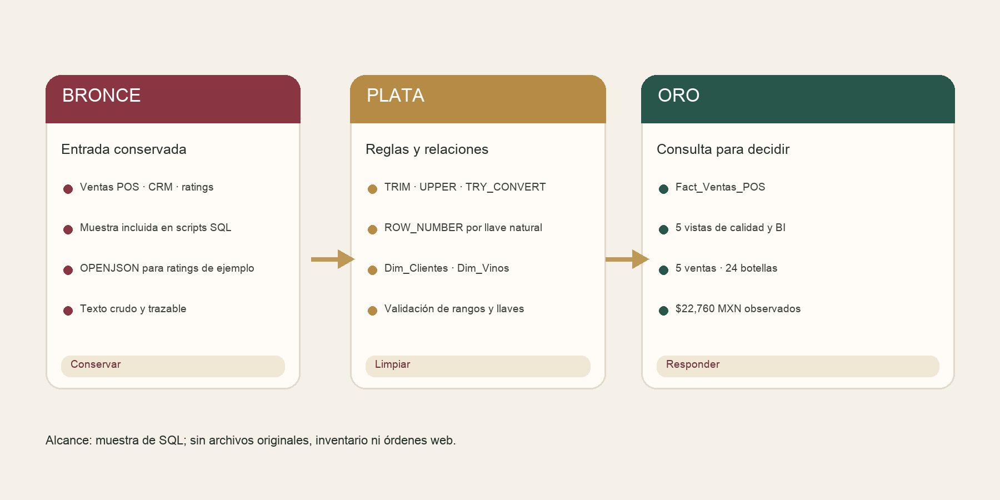
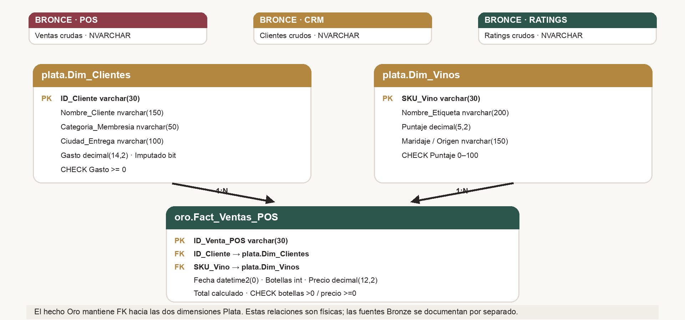

# Viñedos del Alba — Integración de Datos, Equipo 2
### Arquitectura Medallón en Microsoft SQL Server

**Viñedos del Alba** es un nombre ficticio y coherente para este caso académico; no identifica una marca comercial verificada.

**Materia:** Integración de Datos | Universidad Iberoamericana León

**Equipo:** 2 | **Tablero Trello:** [Proyecto Integrador · Viñedos del Alba](https://trello.com/b/fUVw5rtM) *(tablero privado del equipo).*


> El símbolo y el nombre identifican el caso académico ficticio; no representan una marca comercial verificada.

## 1. Descripción del proyecto

El proyecto consolida ventas de punto de venta (POS), clientes del CRM y calificaciones de vinos. El cruce se realiza mediante `ID_Cliente` y `SKU_Vino`. La muestra disponible contiene cinco transacciones POS, cuatro clientes CRM y tres vinos con ratings. No se recibieron datos de inventario ni órdenes de comercio electrónico; por tanto, el análisis no los atribuye al negocio.

La muestra POS suma 24 botellas y $22,760 MXN. Una transacción con cliente nulo se conserva bajo `CLI-MOSTRADOR`. El gasto ausente de `CLI-V02` se completa con $4,920 MXN observados en la muestra POS y se marca `Gasto_Fue_Imputado=1`; no es un gasto anual confirmado.

## 2. Arquitectura de integración (SQL Server)



- **Bronce (`bronce`):** conserva texto crudo de POS, CRM y ratings; permite rastrear filas repetidas y valores que no convierten.
- **Plata (`plata`):** estandariza con `TRIM`/`UPPER`, convierte con `TRY_CONVERT`, resuelve duplicados por llave de negocio con `ROW_NUMBER()` y aplica reglas y claves.
- **Oro (`oro`):** concentra los hechos POS y expone vistas para análisis, calidad y KPIs.

La ingesta de demostración usa datos de referencia incluidos en los scripts SQL y un objeto JSON de ejemplo. No recibimos los archivos fuente originales CSV, Excel o JSON; si el equipo los recupera, debe sustituir la muestra por esas fuentes.

## 3. Modelo entidad-relación (DER)



Las llaves foráneas físicas salen de `oro.Fact_Ventas_POS` hacia `plata.Dim_Clientes` y `plata.Dim_Vinos`. Las líneas punteadas representan transformación ETL, no relaciones físicas.

## 4. Estructura del repositorio (`/src`)

```text
src/
├── 01_ddl_arquitectura_der.sql
├── 02_etl_ingesta_bronce.sql
├── 03_etl_limpieza_plata.sql
└── 04_vistas_gold_bi.sql
assets/
├── logo_negocio.png
├── flujo_medallon_sql.png
├── diagrama_der_sqlserver.png
├── portada-vinicola-golden-hour.png
├── uvas-dorado.png
├── bodega-barricas.png
├── logo_conceptual-alba.png
├── fuente-punto-venta.png
├── clientes-vinicola.png
├── flujo-medallon-fotografico.png
└── insight-de-negocio.png
docs/
├── presentacion-final-equipo-2.pptx / .pdf
├── avance.docx / .pdf
├── demo-y-guion.md
├── guion-rapido-por-integrante.md
├── banco-preguntas-oficial-equipo-2.pdf
├── respuestas-banco-preguntas-por-rol.md
├── plan-b-resultados.md
├── evidencia-ejecucion-sqlserver-2026-11-23.txt
└── guia-presentacion-proyecto-final.pdf
tasks/
└── generate_presentation.py
README.md
```

1. `01_ddl_arquitectura_der.sql`: base de datos, esquemas, tablas, PK, FK y restricciones.
2. `02_etl_ingesta_bronce.sql`: cargas de muestra SQL, CRM y JSON; evita reinsertar una fila idéntica.
3. `03_etl_limpieza_plata.sql`: siete procedimientos, conversiones, estandarización, deduplicación e integración idempotente.
4. `04_vistas_gold_bi.sql`: cinco vistas Oro, KPIs y validaciones cuantitativas.

El deck del avance previo se conserva en `docs/archivo-historico/`; la presentación final editable tiene 13 diapositivas, incluye la matriz de roles, notas del expositor y un plan de 25 minutos; su PDF está junto al PowerPoint. El guion por rol, las dos preguntas prioritarias por integrante y el Plan B están en `docs/demo-y-guion.md`, `docs/guion-rapido-por-integrante.md` y `docs/plan-b-resultados.md`.
La guía de avance anterior también queda en `docs/archivo-historico/`; la guía que rige esta presentación está en `docs/guia-presentacion-proyecto-final.pdf`. Moodle pide 25–35 minutos. El guion usa 15 minutos de exposición/demo, 8 de preguntas y 2 de transiciones (25 minutos en total), en el extremo superior de la guía PDF.

### Ejecución

En SQL Server 2022, abrir y ejecutar los cuatro archivos en orden (`01` → `04`) dentro de una instancia de práctica. Repetir el flujo es seguro para esta carga de demostración: no borra bases ni tablas, la ingesta exacta evita duplicados y la integración vuelve a procesar las llaves sin duplicar ventas Oro.

La carga actual utiliza `INSERT` y `OPENJSON`; no usa `BULK INSERT` porque los archivos originales no se incluyeron. No ejecutar sobre una instancia con políticas que impidan crear `DB_Vinicola_Integration`.

### Calidad y resultados reproducibles

- POS: 5 filas crudas, 5 IDs únicos, 5 ventas Oro; 0 filas inválidas, 0 huérfanos y 1 cliente nulo preservado como anónimo.
- CRM: 4 filas / 4 IDs únicos; 1 gasto imputado como proxy observado.
- Ratings: 3 filas / 3 vinos válidos.
- Oro: 24 botellas; ingresos de $22,760 MXN; venta anónima de $450 MXN.
- Platinum: 12 de 15 botellas (80%) corresponden a vino con puntaje >93; las 12 pertenecen a una sola persona en esta muestra.
- Origen: Rioja 12 botellas (50%), Mendoza 8 (33.33%) y Valle de Guadalupe 4 (16.67%).

La muestra no tiene filas duplicadas. La deduplicación se comprobó en SQL Server 2022 desechable insertando una versión posterior de POS-805; Oro conservó cinco ventas y eligió la fecha más reciente. Los cuatro scripts se ejecutaron dos veces desde una base vacía y mantuvieron los conteos. En otra prueba consulté las cinco vistas y ejecuté los siete procedimientos. La consola real está en `docs/evidencia-ejecucion-sqlserver-2026-11-23.txt`; es salida de `sqlcmd`, no captura de SSMS.

## 5. Integrantes y roles (cinco personas)

La distribución coincide con los cinco roles del banco oficial de evaluación del Equipo 2.

- **Data Architect / SQL Specialist:** José Hernández.
- **Data Engineer / Pipeline Lead:** Patricio García.
- **Data Quality & QA Specialist:** Ximena Ibarra.
- **Líder de Proyecto y BI Specialist:** Ezequiel Aguilera.
- **Documentación y Trello:** Joel Ibarra.

La distribución sigue el banco oficial de evaluación por rol del Equipo 2.
Para ajustarse también a la guía de presentación en equipos de cinco, la exposición divide Liderazgo/BI: Ezequiel conduce y responde la sección comercial; Joel presenta la lectura BI junto con documentación y Trello. La guía corta conserva los nombres del banco oficial para repartir las preguntas.

## Presentación final

La portada y las imágenes de uvas y bodega son visuales conceptuales generados para este proyecto; no representan una ubicación o marca comercial confirmada. La diapositiva de ETL muestra valores reales de la muestra antes y después de estandarizar. La presentación editable, su PDF y la guía de respuestas del banco oficial están en `docs/`.
