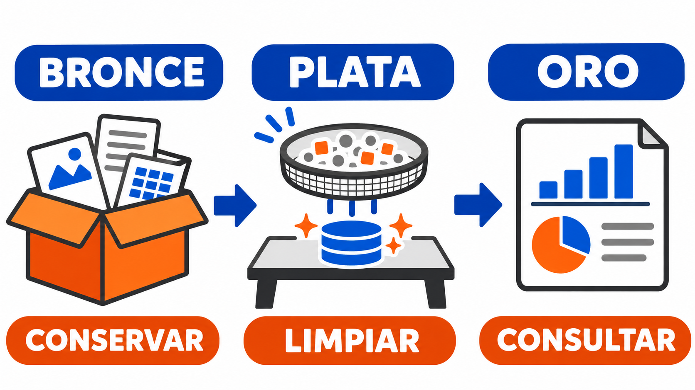
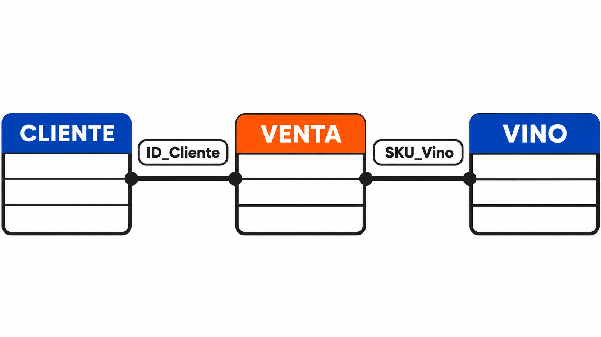

# Viñedos del Alba — Integración de Datos, Equipo 2
### Arquitectura Medallón en Microsoft SQL Server

**Viñedos del Alba** es un nombre ficticio y coherente para este caso académico; no identifica una marca comercial verificada.

**Materia:** Integración de Datos | Universidad Iberoamericana León

**Equipo:** 2 | **Tablero Trello:** [Proyecto Integrador · Viñedos del Alba](https://trello.com/b/fUVw5rtM) *(tablero privado del equipo).*


> El símbolo y el nombre identifican el caso académico ficticio; no representan una marca comercial verificada.

## 1. Descripción del proyecto

El proyecto consolida ventas de punto de venta (POS), clientes del CRM y calificaciones de vinos. El cruce se realiza mediante `ID_Cliente` y `SKU_Vino`. La muestra disponible contiene cinco transacciones POS, cuatro clientes CRM y tres vinos con ratings. No se recibieron datos de inventario ni órdenes de comercio electrónico; por tanto, el análisis no los atribuye al negocio.

La muestra base tiene cinco ventas, cuatro clientes y tres vinos. Para cumplir la indicación reciente del profesor de mostrar entrada sucia, el script agrega dos filas POS sintéticas: una versión duplicada corregida con espacios y una cantidad no convertible. También añade un rating sintético fuera de escala. No se presentan como transacciones reales. La limpieza conserva las cinco ventas válidas, 24 botellas y $22,760 MXN. Una transacción sin cliente se conserva bajo `CLI-MOSTRADOR`. El gasto ausente de `CLI-V02` se completa con $4,920 MXN observados en la muestra POS y se marca `Gasto_Fue_Imputado=1`; no es un gasto anual confirmado.

## 2. Arquitectura de integración (SQL Server)



- **Bronce (`bronce`):** guarda el texto tal como llega, incluso espacios, una fila repetida y valores inválidos, para que se puedan revisar.
- **Plata (`plata`):** limpia espacios/categorías, intenta convertir números, elige la versión más reciente por llave y forma las dimensiones de cliente y vino.
- **Oro (`oro`):** concentra los hechos POS y expone vistas para análisis, calidad y KPIs.

La ingesta de demostración usa datos de referencia incluidos en los scripts SQL y un objeto JSON de ejemplo. No recibimos los archivos fuente originales CSV, Excel o JSON; si el equipo los recupera, debe sustituir la muestra por esas fuentes.

## 3. Modelo entidad-relación (DER)



Las llaves foráneas físicas salen de `oro.Fact_Ventas_POS` hacia `plata.Dim_Clientes` y `plata.Dim_Vinos`. Las líneas punteadas representan transformación ETL, no relaciones físicas.

## 4. Estructura del repositorio (`/src`)

```text
src/
├── 01_ddl_arquitectura_der.sql
├── 02_etl_ingesta_bronce.sql
├── 03_etl_limpieza_plata.sql
└── 04_vistas_gold_bi.sql
assets/
├── logo_negocio.png
├── portada-vinicola-golden-hour.png
├── uvas-dorado.png
├── bodega-barricas.png
├── logo_conceptual-alba.png
├── fuente-punto-venta.png
├── clientes-vinicola.png
├── flujo-medallon-fotografico.png
├── fuentes-vinicola-conceptual.png
├── prueba-recomendacion-conceptual.png
├── insight-de-negocio.png
docs/
├── presentacion-final-equipo-2.pptx / .pdf (14 diapositivas)
├── avance.docx / .pdf
├── demo-y-guion.md
├── guion-rapido-por-integrante.md
├── banco-preguntas-oficial-equipo-2.pdf
├── respuestas-banco-preguntas-por-rol.md
├── plan-b-resultados.md
├── evidencia-ejecucion-sqlserver-2026-11-23.txt
├── guia-presentacion-proyecto-final.pdf
├── captura-sqlserver-demo-2026-11-23.png
└── estado-entregables.md
tasks/
├── generate_presentation.py
└── run-sqlserver-demo.sh
README.md
```

1. `01_ddl_arquitectura_der.sql`: base de datos, esquemas, tablas, PK, FK y restricciones.
2. `02_etl_ingesta_bronce.sql`: carga la muestra base y tres ejemplos sintéticos sucios; evita reinsertar filas idénticas.
3. `03_etl_limpieza_plata.sql`: siete procedimientos, conversiones, estandarización, deduplicación e integración idempotente.
4. `04_vistas_gold_bi.sql`: cinco vistas Oro, KPIs y validaciones cuantitativas.

El deck del avance previo se conserva en `docs/archivo-historico/`; la presentación final editable tiene 14 diapositivas, diagramas como imágenes generadas y notas del expositor. El guion completo programa **25 minutos de exposición y demo**. Las preguntas se responden después; la presentación no muestra sus respuestas. El guion completo y el reparto actualizado están en `docs/vinicola/Guion_Exposicion_25_Minutos.md` y `docs/guion-rapido-por-integrante.md`; el banco de respuestas queda aparte.
La guía que rige esta presentación está en `docs/guia-presentacion-proyecto-final.pdf`. Moodle pide 25–35 minutos; la guía PDF adjunta marca 20–25 minutos. Para cumplir el mínimo de Moodle sin mezclarlo con preguntas, esta versión programa 25 minutos de exposición; las preguntas se dejan para después.

### Ejecución

### Corrida única desde SSMS

Para ejecutar la demostración en una sola operación, abre `src/00_demo_completa_ssms.sql` en SSMS, activa **Consulta > Modo SQLCMD**, conéctate a una instancia de práctica desde `master` y pulsa F5. El script reúne los cuatro pasos en orden y se detiene si la base `DB_Vinicola_Integration` ya existe o si un paso genera un error. No elimina bases ni datos. Requiere permiso para crear la base.

En SQL Server 2022, ejecutar los cuatro archivos en orden (`01` → `04`) dentro de una instancia de práctica. Para una corrida aislada reproducible en macOS con Docker instalado, ejecutar `./tasks/run-sqlserver-demo.sh`; crea una instancia temporal sin puertos publicados y la elimina al cerrar la sesión. No ejecutar sobre una instancia con políticas que impidan crear `DB_Vinicola_Integration`.

La carga actual utiliza `INSERT` y `OPENJSON`; no usa `BULK INSERT` porque los archivos originales no se incluyeron. No ejecutar sobre una instancia con políticas que impidan crear `DB_Vinicola_Integration`.

### Calidad y resultados reproducibles

- POS: 7 filas Bronce, 6 IDs únicos, 1 versión anterior descartada, 1 cantidad inválida excluida y 5 ventas Oro; 0 huérfanos y 1 cliente nulo preservado como anónimo.
- CRM: 4 filas / 4 IDs únicos; 1 gasto imputado como proxy observado.
- Ratings: 4 filas Bronce / 3 vinos válidos; el puntaje sintético de 120 se excluye por exceder el rango 0–100.
- Oro: 24 botellas; ingresos de $22,760 MXN; venta anónima de $450 MXN.
- Platinum: 12 de 15 botellas (80%) corresponden a vino con puntaje >93; las 12 pertenecen a una sola persona en esta muestra.
- Origen: Rioja 12 botellas (50%), Mendoza 8 (33.33%) y Valle de Guadalupe 4 (16.67%).

Las anomalías sintéticas son visibles en Bronce y explicadas por sus resultados: `POS-805` con espacios y versión posterior gana por fecha; `POS-806` contiene `muchas` y no convierte a cantidad; el rating 120 se rechaza. La vista de calidad muestra 7→6→5 para las ventas POS y 4→3 para ratings válidos. Los cuatro scripts se ejecutaron desde una base vacía en SQL Server 2022 y la reejecución mantuvo 5 ventas, 24 botellas y $22,760 MXN. Se consultaron las cinco vistas y siete procedimientos. La consola se capturó como imagen en `docs/captura-sqlserver-demo-2026-11-23.png` y su salida íntegra está en `docs/evidencia-ejecucion-sqlserver-2026-11-23.txt`; ambas evidencias provienen de `sqlcmd` contra SQL Server 2022, no de SSMS.

## 5. Integrantes y roles (cinco personas)

La distribución coincide con los cinco roles del banco oficial de evaluación del Equipo 2.

- **Data Architect / SQL Specialist:** José Hernández.
- **Data Engineer / Pipeline Lead:** Patricio García.
- **Data Quality & QA Specialist:** Ximena Ibarra.
- **Líder de Proyecto y BI Specialist:** Ezequiel Aguilera.
- **Documentación y Trello:** Joel Ibarra.

La distribución sigue el banco oficial de evaluación por rol del Equipo 2.
Para ajustarse también a la guía de presentación en equipos de cinco, la exposición divide Liderazgo/BI: Ezequiel conduce y responde la sección comercial; Joel presenta la lectura BI junto con documentación y Trello. La guía corta conserva los nombres del banco oficial para repartir las preguntas.

## Presentación final

La presentación final se reorganizó como un recorrido fácil de explicar: pregunta de negocio, teoría con una analogía, fuentes y llaves, capas, una fila de ejemplo, ejecución SQL, resultados y límites. Los cuatro diagramas son imágenes generadas para este proyecto, no dibujos hechos con código. La portada es una escena conceptual; la diapositiva de SQL usa la captura real de `sqlcmd`. El guion completo reparte 25 minutos entre los cinco integrantes. Las respuestas al banco de preguntas permanecen en un documento aparte y no se muestran en las diapositivas.


### Apoyos visuales generados

Las imágenes generadas para la presentación están en `assets/vinicola/` (fuentes, relaciones, capas, deduplicación y portada). `evidencia-sql.png` es la captura original de la salida de SQL Server recuperada del historial del proyecto.
